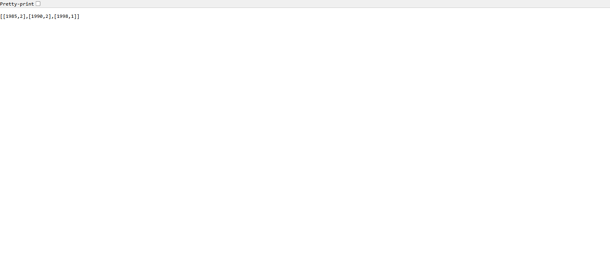
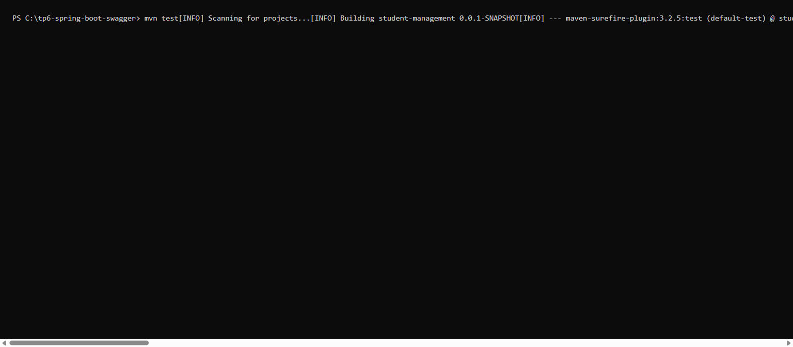
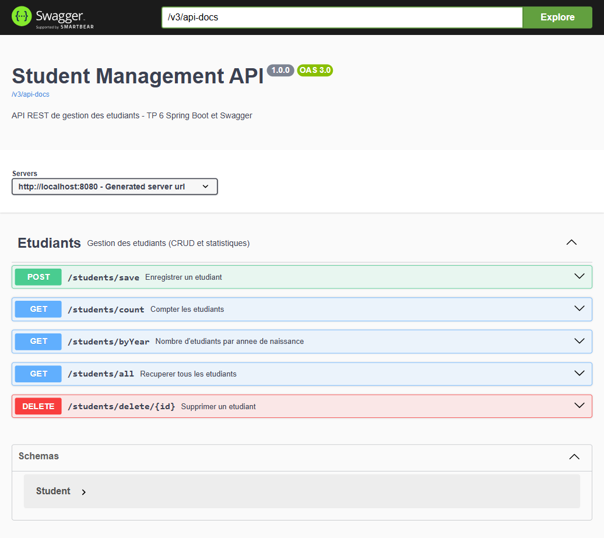
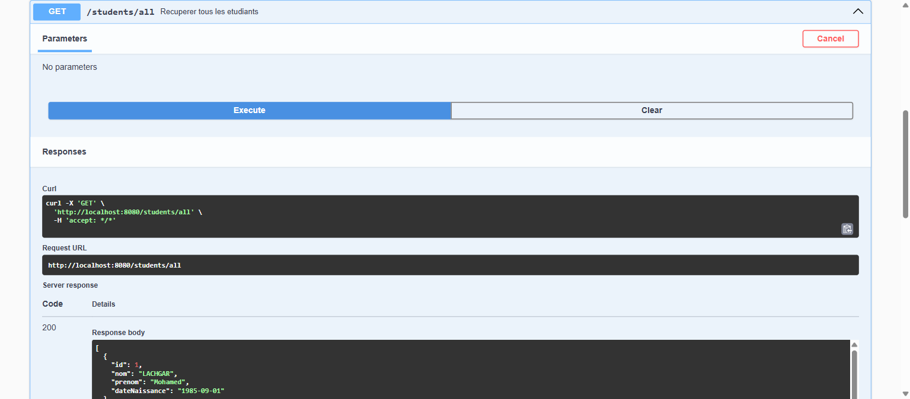

# TP 6 : Spring Boot et Swagger — Documentation d'API Microservices

Application Spring Boot de gestion des étudiants (`Student`) exposant une API REST documentée
automatiquement avec **Swagger / springdoc-openapi**.

## Stack technique

| Élément | Version |
|---|---|
| Spring Boot | 3.3.5 |
| Java | 17+ |
| Spring Web / Data JPA / Validation | starters Spring Boot |
| springdoc-openapi-starter-webmvc-ui | 2.6.0 |
| MySQL | `mysql-connector-j` (profil par défaut) |
| H2 | base en mémoire (profil `h2`, utilisé pour les tests) |
| Tests | JUnit 5 + Mockito + MockMvc |

## Structure du projet

```
tp6-spring-boot-swagger/
├── pom.xml
├── images/
└── src
    ├── main
    │   ├── java/com/example/studentmanagement
    │   │   ├── StudentManagementApplication.java
    │   │   ├── config/OpenApiConfig.java
    │   │   ├── controller/StudentController.java
    │   │   ├── entity/Student.java
    │   │   ├── exception/GlobalExceptionHandler.java
    │   │   ├── repository/StudentRepository.java
    │   │   └── service/StudentService.java
    │   └── resources
    │       ├── application.properties      # MySQL (profil par défaut)
    │       └── application-h2.properties   # H2 (tests / démo sans MySQL)
    └── test/java/com/example/studentmanagement
        ├── StudentControllerTest.java      # tests unitaires (Mockito)
        └── StudentApiIntegrationTest.java  # tests d'intégration (MockMvc + H2)
```

## Étape 1 — Création du projet

Projet généré avec les paramètres de Spring Initializr :

- Project : Maven, Language : Java, Packaging : Jar
- Group : `com.example`, Artifact : `student-management`
- Dépendances : Spring Web, Spring Data JPA, Spring Boot DevTools, Validation, MySQL Driver
  (+ `springdoc-openapi-starter-webmvc-ui` pour Swagger, + H2 pour les tests)

## Étape 2 — Analyse du `pom.xml`

- Héritage du parent `spring-boot-starter-parent` → versions cohérentes des dépendances.
- `spring-boot-starter-web` → contrôleurs REST.
- `spring-boot-starter-data-jpa` → persistance des entités.
- `spring-boot-starter-validation` → validation des entrées (`@Valid`, `@NotBlank`, `@Past`…).
- `spring-boot-starter-test` → JUnit 5, Mockito, MockMvc.
- `springdoc-openapi-starter-webmvc-ui` → génération de la documentation OpenAPI + Swagger UI.

## Étape 3 — Configuration de la base de données

Création de la base :

```sql
CREATE DATABASE studentdb;
```

`src/main/resources/application.properties` :

```properties
spring.datasource.url=jdbc:mysql://localhost:3306/studentdb?serverTimezone=UTC&createDatabaseIfNotExist=true
spring.datasource.username=root
spring.datasource.password=
spring.jpa.hibernate.ddl-auto=update
```

`ddl-auto=update` laisse Hibernate créer / mettre à jour la table `student` à partir de l'entité.

> Un profil `h2` (`application-h2.properties`) permet de lancer l'application sans MySQL :
> `mvn spring-boot:run -Dspring-boot.run.profiles=h2`

## Étape 4 — Entité et Repository

`Student` (`@Entity`) : `id` (auto-incrémenté), `nom`, `prenom`, `dateNaissance` (`@Temporal(DATE)`).

`StudentRepository extends JpaRepository<Student, Integer>` avec une requête JPQL personnalisée :

```java
@Query("SELECT YEAR(s.dateNaissance), COUNT(s) FROM Student s GROUP BY YEAR(s.dateNaissance) ORDER BY YEAR(s.dateNaissance)")
Collection<Object[]> findNbrStudentByYear();
```

## Étape 5 — Service et contrôleur REST

- `StudentService` : logique métier (`save`, `delete`, `findAll`, `countStudents`, `findNbrStudentByYear`),
  injection du repository par constructeur, transactions `@Transactional`.
- `StudentController` (`@RestController`, `@RequestMapping("/students")`) : reçoit les requêtes,
  appelle le service et renvoie une `ResponseEntity` avec le code HTTP approprié.

## Étape 6 — Lancer l'application

```bash
mvn spring-boot:run
```

Le log `Started StudentManagementApplication in X seconds` confirme le démarrage sur le port `8080`.

## Étape 7 — Tester les endpoints REST

| Méthode | Endpoint | Code attendu | Description |
|---|---|---|---|
| POST | `/students/save` | 201 Created | Ajout d'un étudiant |
| GET | `/students/all` | 200 OK | Liste complète |
| DELETE | `/students/delete/{id}` | 204 / 404 | Suppression |
| GET | `/students/count` | 200 OK | Nombre total |
| GET | `/students/byYear` | 200 OK | Répartition par année de naissance |

Exemple :

```bash
curl -X POST http://localhost:8080/students/save \
  -H "Content-Type: application/json" \
  -d '{"nom":"LACHGAR","prenom":"Mohamed","dateNaissance":"1985-09-01"}'
```

Réponses réelles obtenues :

```
POST /students/save   -> 201 {"id":1,"nom":"LACHGAR","prenom":"Mohamed","dateNaissance":"1985-09-01T00:00:00.000+00:00"}
GET  /students/count  -> 200 5
GET  /students/byYear -> 200 [[1985,2],[1990,2],[1998,1]]
DELETE /students/delete/5 -> 204
DELETE /students/delete/99 -> 404
POST /students/save (nom vide) -> 400 {"title":"Donnees invalides","detail":"nom : Le nom est obligatoire, ..."}
```

### Répartition des étudiants par année



## Étape 8 — Tests unitaires (JUnit 5 + Mockito)

`StudentControllerTest` teste le contrôleur en isolation : `@Mock` sur `StudentService`,
`@InjectMocks` sur `StudentController`, vérification des statuts HTTP et des corps de réponse
(`save`, `delete` existant / inexistant, `findAll`, `count`, `byYear`).

`StudentApiIntegrationTest` complète avec des tests d'intégration `MockMvc` sur le profil `h2`
(CRUD complet, validation 400, statistiques par année, exposition de Swagger).

```bash
mvn test
```



## Étape 9 — Intégration de Swagger

Dépendance ajoutée au `pom.xml` :

```xml
<dependency>
    <groupId>org.springdoc</groupId>
    <artifactId>springdoc-openapi-starter-webmvc-ui</artifactId>
    <version>2.6.0</version>
</dependency>
```

Documentation enrichie avec `@Tag`, `@Operation`, `@ApiResponse`, `@Parameter` et `@Schema`,
et métadonnées globales dans `OpenApiConfig` (titre, description, version, contact).

Accès à l'interface :

- Swagger UI : <http://localhost:8080/swagger-ui.html>
- OpenAPI JSON : <http://localhost:8080/v3/api-docs>



Test d'un endpoint directement depuis Swagger UI (`GET /students/all` → 200 OK) :



## Résumé

Ce TP couvre la création complète d'une application Spring Boot : génération du projet,
configuration MySQL, couche entité / repository / service / contrôleur, tests unitaires et
d'intégration, et documentation automatique de l'API avec Swagger.
