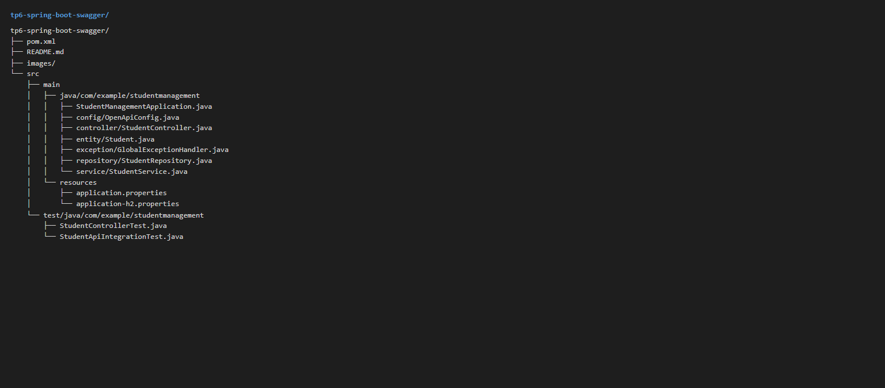
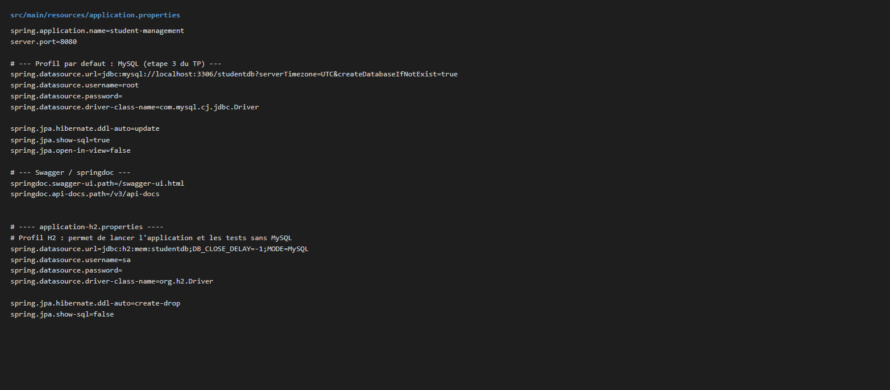
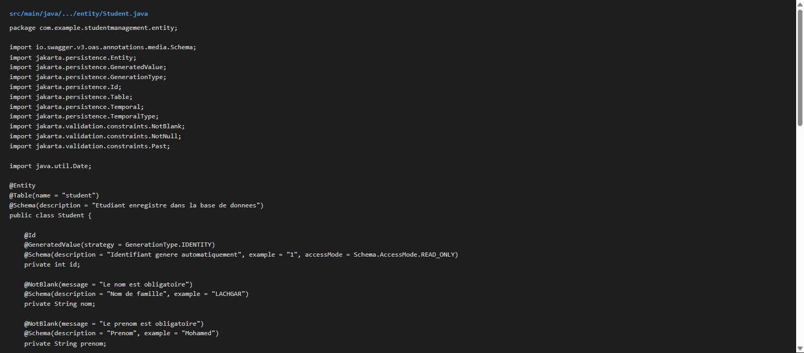
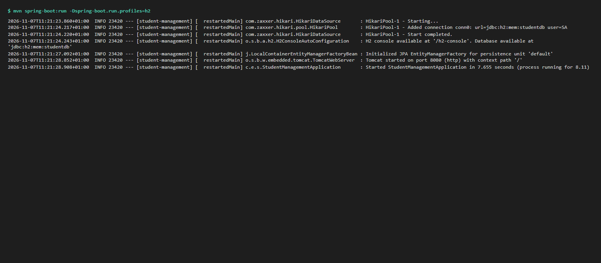
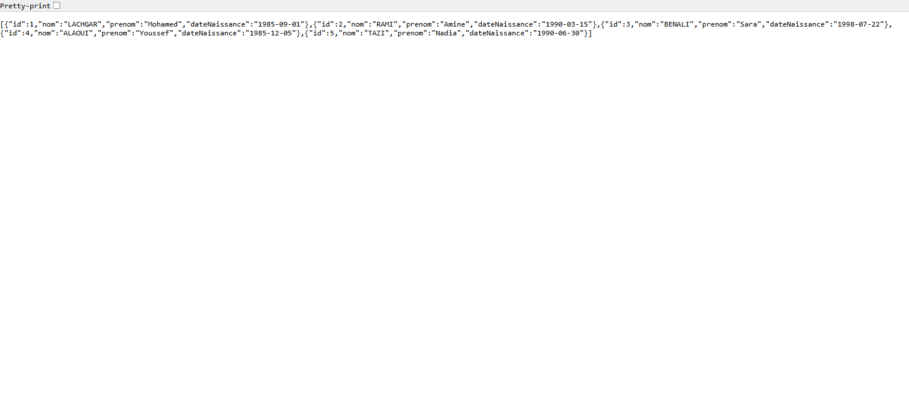
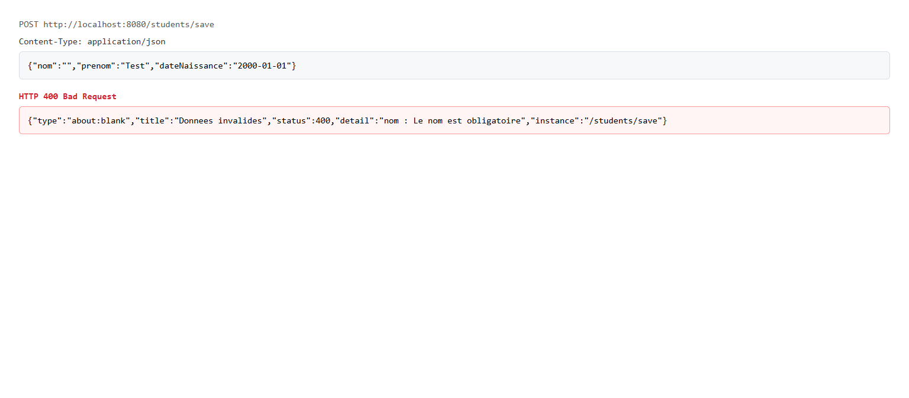

# TP 6 : Spring Boot et Swagger — Documentation d'API avec springdoc-openapi

## Structure du projet : packages `entity`, `repository`, `service`, `controller`, `config` et `pom.xml`

## Configuration MySQL : `application.properties` + profil `h2` pour lancer sans base

## Entite `Student` et `StudentRepository` : `JpaRepository` + requete JPQL `findNbrStudentByYear()`

## Demarrage : `Started StudentManagementApplication` sur le port `8080`

## Endpoints REST : `POST /students/save` -> 201, `GET /students/all` -> 200, `GET /students/count` -> 5

## `GET /students/byYear` : repartition par annee de naissance -> `[[1985,2],[1990,2],[1998,1]]`

## Validation : `POST /students/save` avec un nom vide -> 400 `ProblemDetail`

## Swagger UI : documentation generee automatiquement par springdoc-openapi

## Execution depuis Swagger : `GET /students/all` -> 200 OK

## Tests unitaires et d'integration : `Tests run: 11, Failures: 0` — `BUILD SUCCESS`
